# Assignment 13: Reversible LLMs (midpoint / leapfrog / Hamiltonian)

This directory holds the assignment work on top of Chintana, a modular refactor of
[nanoGPT](https://github.com/karpathy/nanoGPT) (see the repo root `README.md`). `RevGPT` subclasses `chintana.GPT` and reuses its
`Block`, `CausalSelfAttention`, `MLP` and `LayerNorm` modules as they are.

**The assignment:** train a ~20M-parameter LLM for 50M tokens with a fixed batch size. Train it
again with a reversible architecture, and report which variant worked. Train the reversible
model a third time at the largest batch size that fits. Report final loss, speed (tokens/s),
peak memory and other findings.

**The paper:** Gal, Eliasof, Turek, Ascher, Treister, Haber, *Reversing Large Language Models
for Efficient Training and Fine-Tuning*, [arXiv:2512.02056](https://arxiv.org/abs/2512.02056).

**The notebook:** [`assignment13_colab.ipynb`](assignment13_colab.ipynb) runs the full-scale
pipeline end to end on a Colab GPU. [`run_all.py`](run_all.py) runs the same pipeline from a
terminal; its `--preset shakespeare_char` mode produced the results in this README.

> **Status.** **Section 7 has the full-scale results**: 20.1M parameters and 50M FineWeb-Edu
> tokens per run on a Colab T4, with runs 1–3, the variant screen, and the max-batch and depth
> probes. Run 4 (the baseline at its maximum batch) and run 3 at the full one-step maximum are
> still to run (section 7.6). Section 6 is an earlier controlled study on a laptop CPU (Tiny
> Shakespeare, 7.2M parameters; results in `results_cpu/`).

---

## 1. The idea in one paragraph

A standard pre-norm transformer updates the hidden state with a residual step,
`p[l+1] = p[l] + f_l(p[l])`. That is a forward-Euler step of an ODE. Backprop needs every
`p[l]`, so activation memory grows linearly with depth. If the update can be **inverted
exactly**, the backward pass can rebuild `p[l]` from the layers above it instead of reading
it from memory. Activation memory then stops depending on depth, at the price of recomputing
each layer once more. The paper draws these invertible updates from time-reversible
integrators:

| variant (`rev.variant`) | update (paper eq.) | inverse | default step |
|---|---|---|---|
| `baseline` (Euler, not reversible) | `p[l+1] = p[l] + f(p[l])` | none | n/a |
| `midpoint` | `p[l+1] = p[l-1] + 2h f(p[l])` (2.4) | `p[l-1] = p[l+1] - 2h f(p[l])` | `h = 0.5` |
| `midpoint_a` | `p[l+1] = a_l p[l-1] + (1-a_l) p[l] + h f(p[l])` (3.6) | divide by `a_l` | `h = 1`, `a_l` per (3.7) |
| `leapfrog` | `p[l+1] = 2p[l] - p[l-1] + h² f(p[l])` (2.6) | `p[l-1] = 2p[l] - p[l+1] + h² f(p[l])` | `h = 1` |
| `hamiltonian` | `q[l] = q[l-1] + Attn(LN1(p[l-1]))`, `p[l] = p[l-1] + MLP(LN2(q[l]))` (2.8) | subtract in reverse order | n/a |

Here `f(p) = Attn(LN1(p)) + MLP(LN2(p + Attn(LN1(p))))` (eq. 2.5). It is exactly the increment
that a standard chintana `Block` adds to its input, computed from the same modules
(`reversible.block_update`).

**Initial states.** Both states start at the embedding, `p[-1] = p[0] = x` (and `q[0] = p[0]`
for the Hamiltonian). With the default step sizes, the first layer of every two-step rule
therefore reduces to an ordinary residual step (`2h = 1`, `h² = 1`, and `a·x + (1-a)·x = x`).
The model starts from the same place as the baseline and only diverges from it with depth.

**Stability (paper section 3).** For the test equation `f(p) = λp`, a two-step rule
`p[j+1] = a·p[j-1] + b·p[j] + hλ·p[j]` is stable both forward and backward only when `|a| = 1`
and `|b + hλ| ≤ 2`. `midpoint` (`a = 1`) needs purely imaginary λ. `leapfrog` (`a = -1`)
needs real, negative λ. `midpoint_a` gives up per-layer stability to behave like Euler in
expectation. This matters twice over: for training, and for how much float rounding each
variant amplifies when it rebuilds states (section 4).

## 2. Implementation

| file | what it does |
|---|---|
| [`reversible.py`](reversible.py) | the four rules (`TwoStepRule` covers midpoint, midpoint_a and leapfrog as `(alpha, beta, gamma)` coefficients; `HamiltonianRule`), and `_ReversibleStack`, the custom `autograd.Function` that doesn't store activations |
| [`model.py`](model.py) | `RevGPT(chintana.GPT)`, which only overrides `forward()`, plus the fused chunked cross-entropy head |
| [`common.py`](common.py) | the `A13Config` schema (loaded with `chintana.load_config`, like the root `train.py`), data sampling, AdamW, AMP, and the shared `train_step` |
| [`prepare_data.py`](prepare_data.py) | streams FineWeb-Edu (or TinyStories) and writes GPT-2-BPE `train.bin` / `val.bin` |
| [`check_reversible.py`](check_reversible.py) | gradient-equivalence and state-reconstruction checks |
| [`train.py`](train.py) | one run with a fixed token budget; writes `results/runs/<name>/{log.jsonl,summary.json}` |
| [`memory_probe.py`](memory_probe.py) | max batch size, memory vs batch, memory vs depth, and throughput vs batch (analogues of the paper's Table 3, Fig. 3 and Table 4) |
| [`cpu_probe.py`](cpu_probe.py) | CPU-only equivalent of the probe: peak memory and stored-activation bytes per training step (vs batch and depth), and a speed comparison that alternates variants |
| [`report.py`](report.py) | writes `results/summary.md` and `results/plots/*.png` |
| [`config/`](config) | YAML for runs 1-3 |
| [`assignment13_colab.ipynb`](assignment13_colab.ipynb) | Colab runner for all of the above |
| [`run_all.py`](run_all.py) | the same pipeline as the notebook, as one script with selectable stages |

### 2.1 Reversible backprop with one recomputation per layer

`_ReversibleStack.forward` runs all layers with autograd off and saves only the final two
states. `backward` walks the layers from the top down. For a `TwoStepRule` layer
(`new = α·prev + β·cur + γ·f(cur)`) it does three things:

1. It recomputes `fv = f(cur)` **once**, with autograd on. `cur` is already known, because
   it is part of the layer's output state.
2. It uses that same `fv` to invert the step: `prev = (new − β·cur − γ·fv) / α`.
3. It back-propagates through it with a single `torch.autograd.grad`:
   `g_prev = α·g_new`, `g_cur = g_cur_out + β·g_new + γ·Jᵀg_new`, and `g_θ = γ·J_θᵀ g_new`.

The Hamiltonian layer does the same thing twice (MLP half, then attention half). So a
training step costs about one extra forward pass through the trunk, which is the 30-50%
overhead the paper quotes. A naive implementation would pay two extra passes (invert, then
recompute for autograd). Parameter gradients are returned from the `Function` rather than
accumulated as a side effect, so `GradScaler`, gradient clipping and the optimizer all see
an ordinary gradient.

Autograd runs the CUDA backward on its own thread, where autocast is off. The `Function`
therefore captures the caller's autocast state and replays it around the recomputation;
otherwise the rebuilt `f(cur)` would come out in a different precision. The states
themselves stay fp32 (fp32 embedding plus fp16 increment gives fp32), so reconstruction
only pays fp32 rounding on top of whatever differences the kernels introduce.

Dropout must be 0, because the recomputation has to be deterministic. `RevGPT` asserts this.

### 2.2 A finding before any training: with a 50k vocabulary, the logits dominate memory

This 20M model has `d = 256` but a 50304-token vocabulary. One 512-token sequence has
25.8M logits. Stored in fp16, again as fp32 inside `cross_entropy`, and again for the
gradient, that comes to **roughly 200-300 MB per sequence** (by estimate). By a similar
estimate, all nine transformer layers together store about 50 MB per sequence.
Reversibility only removes the second number. So with the stock `lm_head` +
`F.cross_entropy`, the baseline and the reversible trunk should hit OOM at similar batch
sizes, and the effect this assignment is meant to measure would mostly disappear.
(`memory_probe.py` measures this on a GPU. The CPU run in section 6 uses a 65-character
vocabulary, where the head is small.)

So every run (baseline included) uses `loss.impl=fused`
(`model._FusedLinearCrossEntropy`). It computes logits, the log-sum-exp and
`softmax − onehot` in chunks of 1024 tokens. It forms `dL/dh` and `dL/dW` in the forward
pass and keeps only those two tensors. Nothing is recomputed, and peak head memory is one
chunk (about 0.3 GB) regardless of batch size. `softmax − onehot` lies in `[−1, 1]` and is
cast to fp16 before the `1/N` mean scaling (done in fp32), so small probabilities don't flush
to zero under fp16. `memory_probe.py` measures the max batch with **both** heads, so the size
of this effect is part of the reported results.

## 3. Setup (full-scale configuration)

These are the defaults in `common.py`, which the notebook uses. The CPU run behind section 6
scales them down with `config/shakespeare_char.yaml`; section 6.0 lists every difference.

| | |
|---|---|
| model | GPT, `n_layer=9, n_head=8, n_embd=256, block_size=512, bias=False, dropout=0` |
| parameters | **20,091,648**: token embedding 12,877,824 (tied with `lm_head`), position 131,072, 9 blocks × 786,944 = 7,082,496, final LN 256 |
| data | FineWeb-Edu `sample-10BT`, GPT-2 BPE; 55M train and 1M val tokens tokenized, **50M tokens trained** per main run (random 512-token windows) |
| optimizer | AdamW (fused on CUDA), β = (0.9, 0.95), wd 0.1 on ≥2-D tensors, grad clip 1.0 |
| schedule | peak lr 1e-3, 3% linear warmup (at least 10 steps), cosine down to 1e-4 |
| precision | fp16 autocast + `GradScaler` on a T4 (bf16 on Ampere and newer), fp32 master weights; no `torch.compile` |
| run 1 | `baseline`, batch 64 (32,768 tokens/step), 1,526 steps |
| run 2 | chosen reversible variant, batch 64, 1,526 steps; same init, data order and schedule as run 1 |
| run 3 | chosen reversible variant at its **sustained** maximum batch (starts at the one-step max, steps down 5% per out-of-memory restart until a full run completes); same 50M tokens, so about 50M/(B·512) steps; lr scaled by √(B/64), capped at 3e-3 |
| run 4 | baseline at its own sustained maximum batch, same procedure and lr scaling; the max-batch comparison partner for run 3 |
| eval | the same 50 × 32 val windows (0.82M tokens) for every run, 10 evals per run plus step 0 |
| speed | tokens/s over all training steps after the first 5 (batch sampling + fwd + bwd + optimizer), excluding evals |
| memory | `torch.cuda.max_memory_allocated` over the run (includes weights, grads and AdamW state) |

**Choosing the variant.** The pipeline trains all five trunks (baseline plus four reversible
variants) on a short budget (10M tokens at batch 64 at full scale; 0.5M characters at batch 16
in the CPU run) with identical seeds. It picks the non-diverged
reversible variant with the lowest validation loss (`screen_*` runs). The paper reports that
midpoint and leapfrog both work at GPT-2 scale. These short runs are meant to find out
whether that holds at 9 layers and d = 256, and whether `midpoint_a` or `hamiltonian` does
better or worse. With seed 0, the sampled `midpoint_a` coefficients are
`a = [-0.74, -1.46, -1.10, -0.53, -0.92, 1.01, -1.36, 1.12, -0.51]`.

## 4. Correctness checks (measured locally, CPU)

`python experiments/assignment13/check_reversible.py`

**Gradient equivalence, float64, tiny model (6 layers, d = 64).** This compares the
memory-saving backward against ordinary autograd through the same dynamics. The fused head
is compared against `lm_head` + `F.cross_entropy`.

| variant | check | abs. loss diff | grad relative error |
|---|---|---|---|
| midpoint | memory-saving vs autograd | 0 | 3.5e-16 |
| midpoint_a | memory-saving vs autograd | 0 | 1.8e-15 |
| leapfrog | memory-saving vs autograd | 0 | 1.2e-15 |
| hamiltonian | memory-saving vs autograd | 0 | 3.2e-16 |
| baseline | fused CE vs standard CE | 0 | 4.1e-16 |

Every result is at machine precision, so the reversible backward computes the same
gradient, not an approximation of it.

**State reconstruction, float32, full 20M model.** The script runs forward keeping every
state, rebuilds them from the top using only the final two, and reports the worst relative
L2 error over the nine layers:

| variant | worst rebuilt-state error |
|---|---|
| midpoint | 1.6e-06 |
| hamiltonian | 1.2e-06 |
| midpoint_a | 1.4e-05 |
| leapfrog | 1.9e-05 |

These errors follow the stability analysis. The two rules whose inverse is a plain
subtraction (midpoint, Hamiltonian) stay at fp32 rounding level. `midpoint_a` divides by
`|a_l|` as small as 0.51. `leapfrog` has `β = 2`, and its state grows with depth (each
increment is added to a "velocity" that is carried forward). Both end up about 10× higher,
which is still negligible at 9 layers. On a GPU, the script also repeats both checks under fp16
autocast (it adds `cuda_*` rows to `results/summary.md`).

## 5. How to run

**Colab (the full-scale run).** Open `assignment13_colab.ipynb` with a T4 runtime and run all
cells. It clones this branch, installs `tiktoken omegaconf datasets` on top of Colab's own
torch, and runs each `run_all.py` stage in its own cell. Results and the tokenized data are
written to Google Drive (`MyDrive/chintana_assignment13/`) as they are produced. After a
disconnect, run all cells again: finished stages are skipped. It ends with a zip of `results/`.

**Terminal, one command (any CUDA machine):**
```bash
python experiments/assignment13/run_all.py                    # data -> check -> screen -> probe -> run1-4 -> report
python experiments/assignment13/run_all.py --stages run2,run3,report --chosen leapfrog   # re-run some stages
```
Stages are `data, check, screen, probe, run1, run2, run3, run4, report`. The variant is picked
from the `screen_*` runs (5M tokens each) unless `--chosen` is given.

- **Sustained maximum batch.** Runs 3 and 4 start at the one-step maximum batch from
  `results/logs/max_batch.csv`. If a run runs out of GPU memory at any point (`train.py` exits
  with status 75), it restarts 5% smaller, until a whole 50M-token run completes. Every attempt
  is logged in `results/logs/sustained_batch.csv`.
- **Resuming.** A stage whose `results/runs/<name>/summary.json` already exists is skipped, so
  re-running the same command continues after an interruption. `--force` redoes everything.
- **Results folder.** Set `A13_RESULTS_DIR` to write results somewhere other than `results/`.

**Locally on a CPU (e.g. a laptop), with Tiny Shakespeare: the configuration used for the
results in section 6.** The FineWeb runs take about
12 hours each on a CPU, so there is a small preset, `config/shakespeare_char.yaml`. It
uses the repo's already-tokenized `data/shakespeare_char` (1.0M characters, 65-symbol
vocabulary), `block_size 256`, batch 16 and 2M-token runs. The trunk is the same 9 × 256;
with a 65-character vocabulary that is **7.2M parameters** (for about 20M, add
`model.n_layer=11 model.n_head=6 model.n_embd=384`). On an Intel i7-9750H it trains at about
4,500 tokens/s (baseline) and 3,600 tokens/s (reversible) when the machine is otherwise idle
(section 6.4). The whole pipeline takes about 1.5 hours:
```bash
uv run python experiments/assignment13/run_all.py --preset shakespeare_char
```
This runs `check`, then 0.5M-token screening of all five trunks. Its `probe` stage runs
`cpu_probe.py`, because `memory_probe.py` needs CUDA. Then come runs 1-2 at batch 16, run 3 at
batch 64 (lr ×2), run 4 (the baseline at the same batch 64), and the report. It skips
`data`, because the files already exist. Section 6 has the results of this pipeline, stored
in `results_cpu/`. To write a new CPU run there instead of `results/`, prefix the command with
`A13_RESULTS_DIR=experiments/assignment13/results_cpu`.

**Terminal, step by step:**
```bash
A=experiments/assignment13
python $A/prepare_data.py                                   # ~56M FineWeb-Edu tokens
python $A/check_reversible.py
for v in baseline midpoint midpoint_a leapfrog hamiltonian; do
  python $A/train.py rev.variant=$v run.name=screen_$v data.total_tokens=5000000
done
python $A/memory_probe.py --variants baseline,midpoint     # use the chosen variant
python $A/train.py $A/config/run1_baseline.yaml
python $A/train.py $A/config/run2_reversible.yaml rev.variant=midpoint
python $A/train.py $A/config/run3_reversible_maxbatch.yaml rev.variant=midpoint data.batch_size=<from max_batch.csv>
python $A/train.py $A/config/run1_baseline.yaml run.name=run4_baseline_maxbatch optim.lr_scaling=sqrt \
    data.batch_size=<baseline max from max_batch.csv>
python $A/report.py
```
Scripts import `chintana` from the repo root (`uv run python ...` locally, or
`PYTHONPATH=<repo>` on Colab). Every hyperparameter is a dotted override (`optim.lr=2e-3`,
`rev.h=0.25`, `loss.impl=standard`, ...); see `A13Config` in `common.py`.

## 6. Assignment results: CPU run on Tiny Shakespeare

This section answers the assignment question: **final loss, speed (tokens/s), peak memory
and other findings**. Everything here was measured on an Intel i7-9750H laptop CPU (6 cores,
16 GB RAM, fp32) with `run_all.py --preset shakespeare_char`, followed by `cpu_probe.py` for
memory and controlled speed. The raw numbers are in [`results_cpu/summary.md`](results_cpu/summary.md),
`results_cpu/runs/` and `results_cpu/logs/`.

### 6.0 How this run differs from the assignment spec

| | Assignment | This run | Why |
|---|---|---|---|
| hardware | Colab GPU | laptop CPU | a controlled CPU study; the full-scale GPU run is section 7 |
| data | 50M tokens | Tiny Shakespeare, character level, 1.0M train / 0.11M val characters | 50M tokens would take about 12 h per run on this CPU |
| model | ~20M params | **7.16M params** (same 9 × 256 trunk; the 65-character vocabulary removes the 12.9M-parameter GPT-2 embedding) | speed; add `model.n_layer=11 model.n_head=6 model.n_embd=384` for a 19.6M character model |
| tokens per run | 50M | **2M** (about 2 epochs) | speed |
| fixed batch | "that you can run" | 16 × 256 tokens | |
| run 3 batch | maximum that fits | **64** (4×) | a 16 GB CPU has no hard memory cap at this size (both trunks fit batch 128), so run 3 uses 4× the batch, which the reversible model fits in **less** memory than the baseline needs at batch 16 (section 6.3) |

Everything else follows section 3: the same initialization, seed, data order, AdamW and
cosine schedule for every run, and the same 20 × 16 fixed validation windows.

### 6.1 Which reversible variant worked

All four reversible variants trained stably. None diverged, and all ended within 0.013 of
each other and of the baseline. The screening runs used 0.5M characters each, batch 16, and
123 steps:

| variant | final val loss | final train loss | diverged |
|---|---|---|---|
| baseline (Euler, not reversible) | 2.4792 | 2.4757 | no |
| midpoint (2.4) | 2.4805 | 2.4711 | no |
| **midpoint_a (3.6)**, chosen | **2.4684** | 2.4550 | no |
| leapfrog (2.6) | 2.4691 | 2.4618 | no |
| hamiltonian (2.8) | 2.4699 | 2.4618 | no |

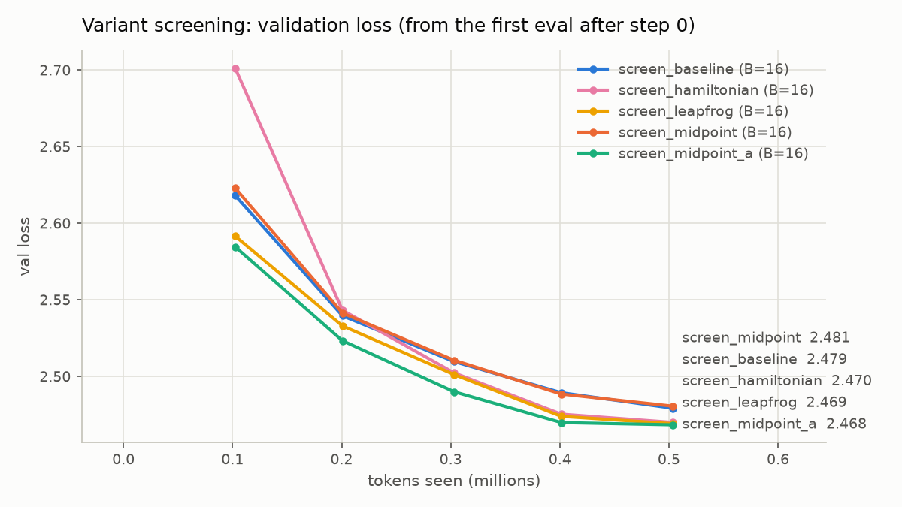

`midpoint_a` had the lowest validation loss, so the pipeline's rule chose it for runs 2 and 3.
Its lead over leapfrog (0.0007) and Hamiltonian (0.0015) is far smaller than what one seed
can resolve, so this run does **not** show that any variant is better than another. It shows
that all four work. The Hamiltonian variant started noticeably slower (val 2.70 at the first eval, vs 2.58–2.62
for the others) and caught up by 0.2M characters.

### 6.2 Final loss

| run | variant | batch | steps | final train loss | final val loss | Δ val vs run 1 |
|---|---|---|---|---|---|---|
| run 1 | baseline | 16 | 489 | 2.1478 | **2.1844** | n/a |
| run 2 | midpoint_a | 16 | 489 | 2.1493 | **2.1952** | +0.011 (+0.5%) |
| run 3 | midpoint_a | 64 | 123 | 2.4058 | **2.4200** | +0.236 |


- **Reversibility costs almost nothing in quality.** At the same batch, run 2's training loss
  matches run 1's to 0.0015 and its validation loss is 0.5% higher. The two curves overlap for
  the whole run. With a single seed, a 0.011 gap can't be separated from noise.
- **Run 3's higher loss comes from the fixed token budget, not from reversibility.** At batch
  64 the same 2M characters give only 123 optimizer steps instead of 489. The √4 = 2× learning
  rate only partly makes up for the missing updates. Run 2 (the same variant at batch 16)
  shows that the reversible model itself trains as well as the baseline.
- All three runs completed their cosine schedule to the minimum learning rate, and none
  diverged. Final-step samples (prompt `ROMEO:`) are in `results_cpu/summary.md`; all three are
  at the "Shakespeare-shaped gibberish" stage expected after 2M characters.

### 6.3 Peak memory

The two CPU memory numbers per configuration are defined in `cpu_probe.py`. Each comes from one
full training step (forward, backward, AdamW) in a fresh process:

- **peak**: how much one training step raises the process's peak memory above the fixed
  model and optimizer state (about 115 MB for 7.16M parameters: fp32 weights, grads and two
  AdamW moments). This is the CPU equivalent of `torch.cuda.max_memory_allocated` minus the
  static state. It includes the transient memory of the reversible backward, which re-runs one
  layer at a time.
- **saved**: the exact bytes autograd holds for the backward pass, counted with
  `saved_tensors_hooks`. This is the stored activation memory that reversibility removes.

| batch | baseline peak | midpoint_a peak | reduction | baseline saved | midpoint_a saved |
|---|---|---|---|---|---|
| 16 (runs 1, 2) | 591 MB | **132 MB** | **4.5×** (−78%) | 586 MB | 12 MB |
| 64 (run 3) | 2,408 MB | **517 MB** | **4.7×** (−79%) | 2,343 MB | 48 MB |
| 128 | 4,526 MB | **1,030 MB** | **4.4×** (−77%) | 4,686 MB | 97 MB |

All four reversible variants use the same memory: 12.1 / 48.3 / 96.6 MB saved at batch
16 / 64 / 128. Midpoint, midpoint_a and leapfrog peak at 132 MB at batch 16, and the
Hamiltonian at 140 MB, because its backward runs two half-steps.

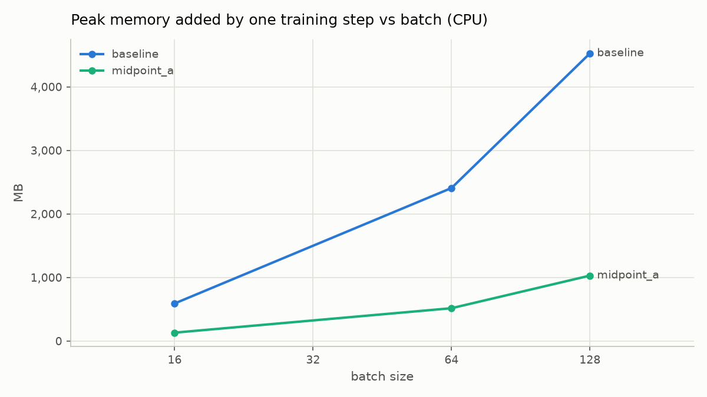

**Peak memory vs depth** (batch 16), the analogue of the paper's Fig. 3:

| n_layer | 3 | 6 | 9 | 18 | 36 |
|---|---|---|---|---|---|
| baseline peak (MB) | 223 | 408 | 591 | 1,142 | 2,153 |
| midpoint_a peak (MB) | 131 | 132 | 132 | 131 | 130 |

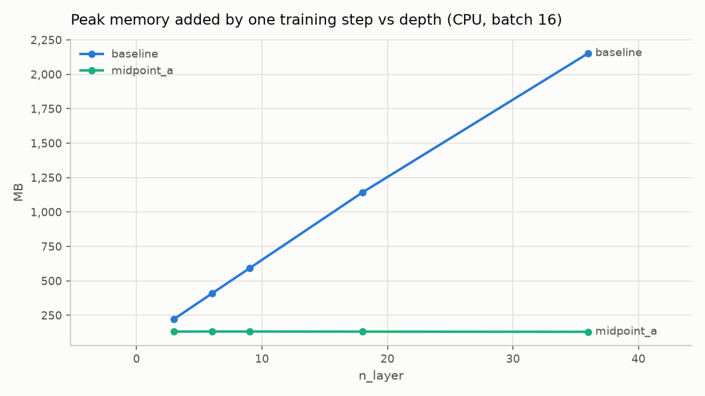

- **Baseline memory grows linearly with depth, at about 60 MB per layer at batch 16. The
  reversible model's memory is flat**: 130–132 MB from 3 to 36 layers. That's the paper's
  central claim, reproduced. At 36 layers the gap is 16×.
- **Stored activations drop about 48×** (586 → 12 MB). What remains is the two final states
  and the loss head's two gradient tensors. Peak memory drops less, **about 4.5×**, because the
  backward still has to hold one layer's recomputed activations at a time. The per-layer cost
  is paid once instead of 9 times, so the saving grows with depth, as the table shows.
- **At the baseline's memory budget, the reversible model fits about 4.5× the batch.** Run 3
  at batch 64 peaks at 517 MB, *below* the 591 MB the baseline needs at batch 16. This is the
  CPU counterpart of the paper's max-batch table (their ~10× came from deeper models).

### 6.4 Speed (tokens/s)

The tokens/s logged by the training runs themselves is **not** a fair comparison here. The
laptop was running other work: run 1's per-step speed varied from 2,009 to 3,545 tokens/s
within the run, and it came out *slower* (2,496) than the reversible run 2 (2,544), even
though the same baseline config ran at 3,469 in its screening run. So speed was re-measured
with `cpu_probe.py`, on an otherwise idle machine. It alternates baseline and reversible runs
(A B A B ...) so that any remaining background load hits both equally, and reports the median
of 5 repetitions of 5 timed steps:

| batch | baseline (min–max) | midpoint_a (min–max) | fewer tokens/s | more time per token |
|---|---|---|---|---|
| 16 | **4,532** (3,871–4,636) | **3,616** (3,521–3,775) | **−20%** | +25% |
| 64 | **4,291** (4,082–4,412) | **3,375** (3,353–3,558) | **−21%** | +27% |

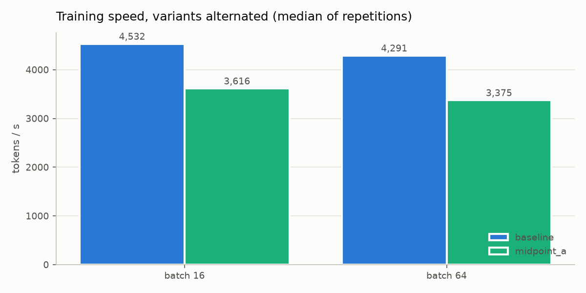

For reference, the as-logged numbers from the runs were 2,496 (run 1), 2,544 (run 2) and
2,790 (run 3) tokens/s, with wall-clock times of 14.1, 13.8 and 12.7 minutes.

- **Reversible training gets about 20% fewer tokens/s,** which is 25–27% more time per token,
  at both batch sizes. That's the cost of re-running each layer once more in the backward
  pass. It is below the paper's quoted 30–50% overhead, because one recomputation per layer
  serves both the reconstruction and the gradients (section 2.1).
- **On a CPU, the larger batch buys no throughput.** Going from batch 16 to 64 makes both
  slightly *slower*: the baseline by 5% and the reversible model by 7%. A CPU is already fully busy at batch 16,
  so the paper's throughput gains (its Table 4) cannot appear here. Those come from GPUs,
  where a memory-limited baseline is stuck at a small batch that under-uses the device. The
  reversible memory savings are real (6.3), but on this hardware they buy capacity (bigger
  batches or deeper models in the same RAM), not speed.

### 6.5 Other findings

1. **Exact gradients.** In float64 the memory-saving backward matches ordinary autograd to
   about 1e-15 for every variant (section 4). This is an exact computation, not an
   approximation.
2. **Reconstruction error follows the stability analysis.** Rebuilding states in fp32 drifts
   by 1.2e-6 (Hamiltonian) and 1.6e-6 (midpoint), whose inverse is a subtraction. It drifts by
   1.4e-5 (midpoint_a, which divides by |a_l| as small as 0.51) and 1.9e-5 (leapfrog, whose
   state grows with depth). All are negligible at 9 layers and none affected training (6.2).
3. **The first reversible layer is a plain residual step** with these initial states (section
   1), and all variants start from about the same loss as the baseline (4.19–4.25 at step 0).
4. **The loss head matters as much as the trunk.** Here the vocabulary is 65, so the logits
   are small. With GPT-2's 50k vocabulary, the stock `lm_head` + `cross_entropy` would store
   more memory than all nine layers together. That is why every run uses the fused chunked
   head (section 2.2). `memory_probe.py` measures that effect directly on a GPU (section 7).

### 6.6 Summary

| | run 1 baseline (B=16) | run 2 reversible (B=16) | run 3 reversible (B=64) |
|---|---|---|---|
| final val loss | 2.1844 | 2.1952 | 2.4200 |
| final train loss | 2.1478 | 2.1493 | 2.4058 |
| tokens/s (controlled, idle machine) | 4,532 | 3,616 | 3,375 |
| peak memory per step | 591 MB | **132 MB** | 517 MB |
| optimizer steps | 489 | 489 | 123 |

**Summary.** Reversible midpoint_a reached baseline quality (+0.5% val loss) with **4.5× less
peak memory** at the same batch, and its memory stayed **flat as depth grew** while the
baseline's grew linearly. The price was **about 20% fewer tokens/s** on a CPU. The saved memory
let a 4× larger batch run inside the baseline's footprint. But with a fixed token budget, that
larger batch meant 4× fewer updates and a worse loss, and on a CPU it gave no throughput gain.


## 7. Full-scale results: 20.1M parameters, 50M tokens, Tesla T4

This is the assignment at the specified scale: the 20,091,648-parameter model from section 3,
trained on 50M FineWeb-Edu tokens per run, on a Colab Tesla T4 (14.6 GB usable) with fp16 autocast. The
raw numbers are in [`results/summary.md`](results/summary.md), `results/runs/` and
`results/logs/`.

> **Still to run:** run 4 (the baseline at its own maximum batch) and run 3 at the full
> one-step maximum (1,503). This session ran an older notebook, which used 95% of the maximum
> for run 3 and treated run 4 as optional. Both are covered in section 7.6.

### 7.1 Which reversible variant worked

All four reversible variants trained stably, and **all four beat the baseline** in a
10M-token screen (306 steps at batch 64, same seed and data order):

| variant | final val loss | Δ vs baseline | tokens/s | peak memory |
|---|---|---|---|---|
| baseline | 6.4018 | n/a | 46,937 | 3.46 GB |
| midpoint | 6.3771 | −0.025 | 41,361 | 0.94 GB |
| **midpoint_a**, chosen | **6.2903** | **−0.112** | 40,296 | 0.94 GB |
| leapfrog | 6.3616 | −0.040 | 40,218 | 0.94 GB |
| hamiltonian | 6.3625 | −0.039 | 41,898 | 0.94 GB |

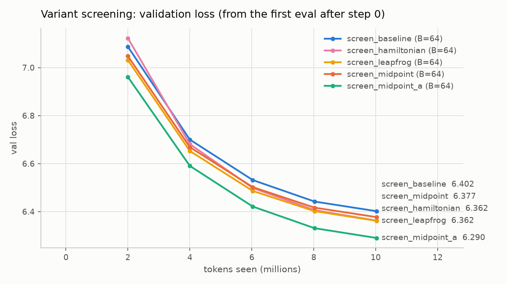

`midpoint_a` led at every evaluation after step 0, by 0.07 over the next-best variant at the end. That is
the same variant the CPU screen picked (section 6.1), where the margins were too small to
mean anything. Here the lead is clearer, but it is still one seed and early in training.
Section 7.2 shows the advantage did not last to 50M tokens.

### 7.2 Final loss (50M tokens each)

| run | variant | batch | steps | final train loss | final val loss | Δ val vs run 1 |
|---|---|---|---|---|---|---|
| run 1 | baseline | 64 | 1,526 | 4.9826 | **5.0895** | n/a |
| run 2 | midpoint_a | 64 | 1,526 | 4.9733 | **5.0881** | −0.0014 |
| run 3 | midpoint_a | 1,424 | 69 | 6.8869 | **6.9213** | +1.83 |

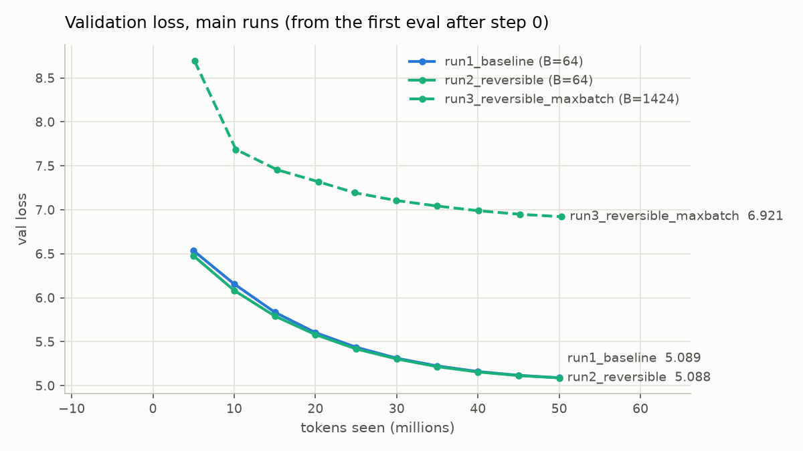
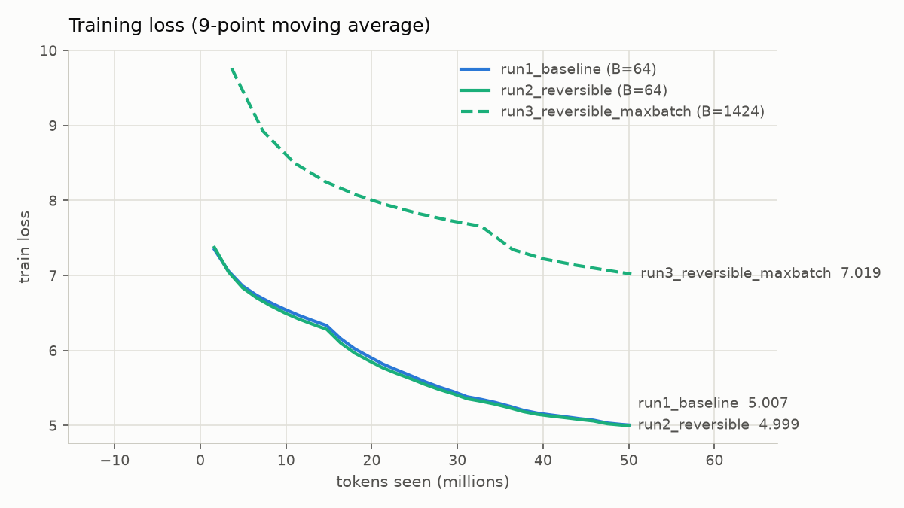

- **At the same batch, the reversible model matches the baseline.** It was ahead early
  (val 6.475 vs 6.533 after 5M tokens) and level by the end: 5.0881 vs 5.0895, a difference of
  0.0014. This is the paper's quality claim, reproduced at 20M parameters and 50M tokens.
- **The maximum-batch run is far worse, because it made far fewer updates.** At batch 1,424 the
  same 50M tokens give only 69 optimizer steps instead of 1,526. The √-scaled learning rate hit
  its 3e-3 cap (the rule asked for 4.7e-3), so it could not make up the difference. Run 2,
  the same variant at batch 64, shows reversibility itself is not the cause.
- No run diverged, and no step had a non-finite loss. Samples are in `results/summary.md`:
  runs 1 and 2 produce fluent but meaningless English, while run 3 is still word salad.

### 7.3 Peak memory

`torch.cuda.max_memory_allocated` over the whole run. This includes about 0.32 GB of fixed
state: fp32 weights, gradients and two AdamW moments for 20.1M parameters.

| run | batch | peak memory | of the T4's 14.6 GB |
|---|---|---|---|
| run 1 baseline | 64 | **3.46 GB** | 24% |
| run 2 reversible | 64 | **0.94 GB** (3.7× less) | 6% |
| run 3 reversible | 1,424 | **13.59 GB** | 93% |

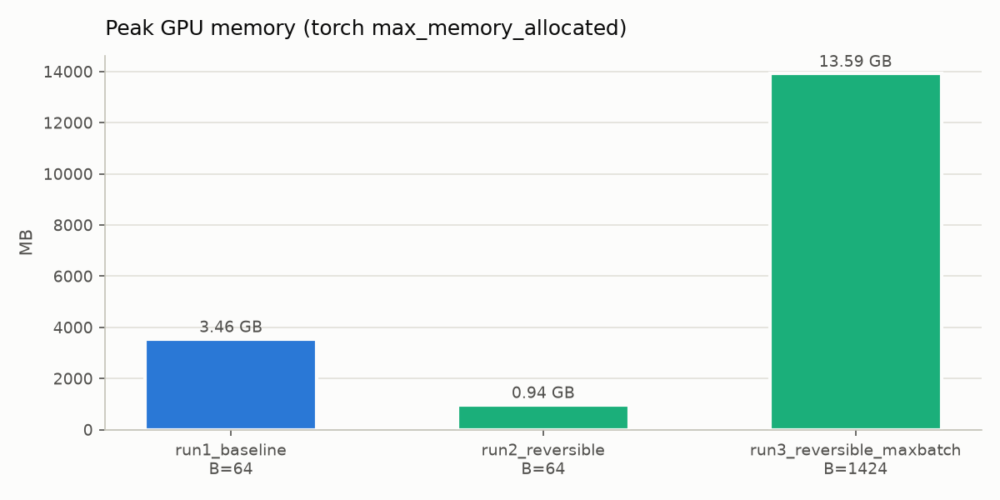

**Maximum batch that survives one full training step** (`memory_probe.py`), with the chunked
loss head used in every run and with the standard full-logits head:

| trunk | chunked loss head | standard loss head |
|---|---|---|
| baseline | 328 | 42 |
| midpoint_a | **1,503** (4.6×) | 48 (1.1×) |

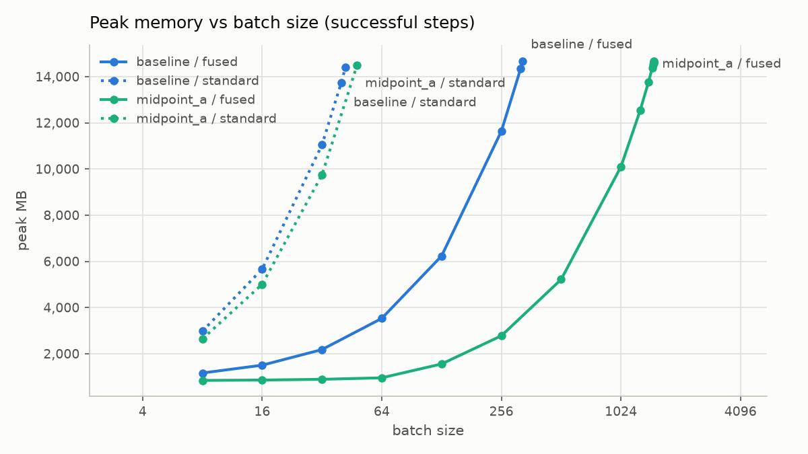

**Peak memory vs depth** at batch 32, the analogue of the paper's Fig. 3:

| n_layer | 2 | 8 | 16 | 32 | 64 |
|---|---|---|---|---|---|
| baseline | 1.06 GB | 1.97 GB | 3.19 GB | 5.61 GB | 10.46 GB |
| midpoint_a | 0.80 GB | 0.86 GB | 0.94 GB | 1.10 GB | 1.43 GB |

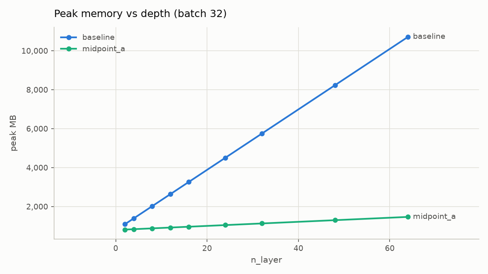

- **At the same batch, reversible training needs 3.7× less GPU memory** (3.46 → 0.94 GB). That
  lets it fit **4.6× the batch** (328 → 1,503) on the same GPU.
- **Memory vs depth reproduces the paper's Fig. 3.** The baseline adds about 150 MB per layer at
  batch 32. The reversible model adds about 10 MB per layer, which is roughly what one layer's
  own weights, gradients and Adam state cost (12.6 MB); its stored activations don't grow. At
  64 layers the gap is 7.3×.
- **The loss head confirms section 2.2.** With the standard head, the 50k-vocabulary logits
  dominate memory: the baseline fits batch 42 and the reversible model only 48. Reversibility
  buys almost nothing there. The chunked head alone raises the baseline's maximum 7.8×
  (42 → 328), and only together with reversibility does the batch reach 1,503.

### 7.4 Speed (tokens/s)

On the GPU, speed within each run was steady to about ±1%, so the runs' own numbers are
reliable (unlike the laptop runs in section 6.4).

| run | batch | tokens/s | wall clock |
|---|---|---|---|
| run 1 baseline | 64 | **46,140** | 19.2 min |
| run 2 reversible | 64 | **40,281** (−12.7%) | 21.8 min |
| run 3 reversible | 1,424 | **40,615** | 21.8 min |

**Throughput vs batch** (`memory_probe.py`, 5 timed steps per point):

| batch | 8 | 16 | 64 | 256 | 328 | 1,024 |
|---|---|---|---|---|---|---|
| baseline | 43,365 | 45,131 | 45,340 | **46,942** | 36,529 | n/a (too large) |
| midpoint_a | 37,989 | 39,634 | 40,188 | 40,408 | n/a | **40,605** |

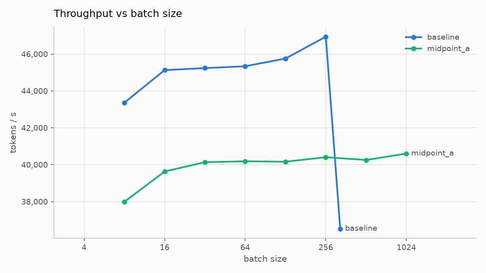

- **Reversible training costs 12.7% in tokens/s at the same batch** (14.5% more time per
  token). That is less than the 20% measured on the CPU (section 6.4), and below the paper's
  30–50%.
- **A bigger batch buys almost no throughput on the T4.** Both trunks are flat from batch 16
  onward. Run 3 at batch 1,424 was only 0.8% faster than run 2 at batch 64. Even at their best,
  the reversible model peaks at 40.6k tokens/s and the baseline at 46.9k. The paper's throughput
  gains (its Table 4) come from baselines that could only fit very small batches. A 20M model on
  a T4 is already compute-bound at batch 16, so there is no headroom for a bigger batch to use.
- **At its absolute memory limit, the baseline slows down sharply**: 36.5k tokens/s at batch
  328, using 98% of memory, versus 46.9k at 256. The reversible model showed no such slowdown,
  even in run 3 at 93% of memory.

### 7.5 Numerical findings under fp16

| check (GPU, fp16 autocast) | midpoint | midpoint_a | leapfrog | hamiltonian |
|---|---|---|---|---|
| gradient vs ordinary autograd (relative error) | 1.1e-2 | 1.2e-2 | 1.0e-2 | 9.5e-3 |
| worst rebuilt-state error, fp16 | 1.6e-3 | 1.2e-2 | 8.4e-3 | 1.2e-3 |
| worst rebuilt-state error, fp32 | 1.7e-6 | 1.5e-5 | 1.9e-5 | 1.2e-6 |

- **In fp32, the GPU's rebuilt-state errors match the CPU's** (1e-6 to 2e-5), and the reversible
  backward is exact (section 4).
- **Under fp16 autocast, rebuilt states drift by 0.1–1%, and gradients differ from autograd by
  about 1%.** The likely cause is that each layer's input is rounded to fp16 before its
  matrix multiplies. A rebuilt state that is off by even fp32 rounding can then round to a
  different fp16 value, so the recomputed layer output shifts by an fp16 step, and the shift
  carries to the next layer down. As the stability analysis predicts, the rules that divide or
  multiply (`midpoint_a`, `leapfrog`) amplify it about 10× more than the plain-subtraction
  rules (`midpoint`, `hamiltonian`). It made no difference to training: run 2 matched run 1
  (7.2).
- The fused and standard loss heads agree on the loss (1.6e-5) but not on the fp16 gradient
  (13%). This check runs without loss scaling, so the likely culprit is the standard head's
  fp16 logits gradient underflowing, which the fused head avoids by design (section 2.2). I
  have not verified this against an fp32 reference. Every training run used the fused head
  with `GradScaler`.

### 7.6 Still to run

To complete the maximum-batch comparison, rerun the notebook from this branch. Before you
run it, copy this `results/` folder into `MyDrive/chintana_assignment13/results/` so that
finished stages are skipped:

- **Run 4:** the baseline trained at its sustained maximum batch, starting from 328. About 30
  minutes including re-tokenizing the data.
- **Run 3 at batch 1,503** (`REDO_RUN3 = True`): starts at the full one-step maximum, steps down
  only on out-of-memory, and logs every attempt in `results/logs/sustained_batch.csv`. About
  25 minutes.

### 7.7 Summary

| | run 1 baseline (B=64) | run 2 reversible (B=64) | run 3 reversible (B=1,424) |
|---|---|---|---|
| final val loss | 5.0895 | 5.0881 | 6.9213 |
| tokens/s | 46,140 | 40,281 | 40,615 |
| peak GPU memory | 3.46 GB | **0.94 GB** | 13.59 GB |
| optimizer steps | 1,526 | 1,526 | 69 |

At full scale, reversible `midpoint_a` matched the baseline's loss with **3.7× less GPU
memory** and **12.7% fewer tokens/s**. Its memory stayed flat with depth while the baseline's
grew linearly, and it fit **4.6× the batch**. On a T4 that bigger batch buys no throughput,
and with a fixed 50M-token budget it costs a great deal of loss.

## 8. Caveats

- The step sizes `h` are the defaults in the table in section 1, not tuned values. `rev.h` is
  a normal config override.
- `midpoint_a` draws its `a_l` once, at construction (seeded, recorded in `summary.json`),
  rather than per step. This keeps every forward pass exactly invertible.
- The Hamiltonian readout is `p[L]`, as in eq. (2.3). Reformer-style models average or
  concatenate `(p, q)` instead.
- Every result comes from one seed (1337). Differences in validation loss smaller than about
  0.01 (the screening ranking, and run 1 vs run 2) can't be separated from seed noise.
- The CPU peak-memory numbers in section 6.3 are the growth above the fixed state. That state is
  fp32 weights, grads and two AdamW moments, about 115 MB for 7.16M parameters, and it is the
  same for every run. (At full scale it is about 0.32 GB for 20.1M parameters.)
- CPU speed is sensitive to other work on the machine. Section 6.4 uses the controlled,
  idle-machine measurement, not the tokens/s logged by the training runs.
- `torch.compile` is off for every run. That keeps the baseline and the reversible
  `autograd.Function` on equal footing, but it means absolute tokens/s is lower than a
  compiled model would reach.
