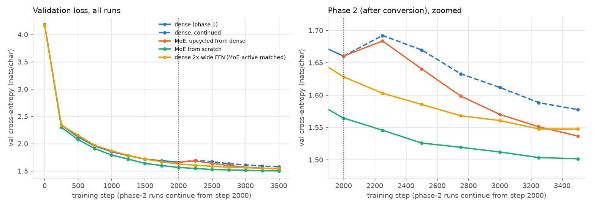
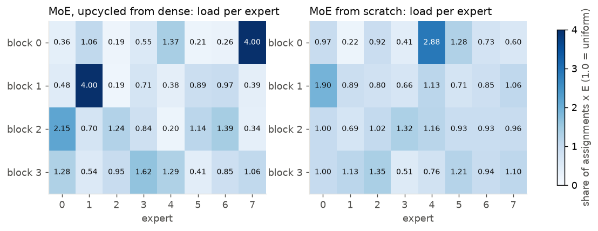
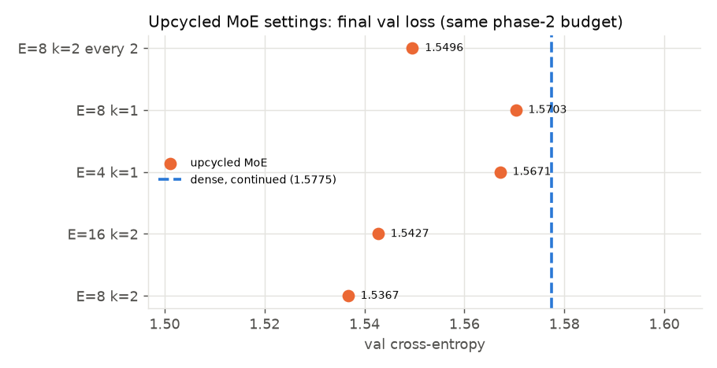

# Assignment 14 results

Generated by `report.py` from `results/runs/`.

## Main runs

| run | model | init | steps | total params | active params | start val | final train | final val | tokens/s | wall (min) |
|---|---|---|---|---|---|---|---|---|---|---|
| dense | dense | scratch | 2000 | 0.812M | 0.812M | 4.1809 | 1.4772 | **1.6603** | 15,782 | 8.9 |
| dense_continue | dense | resume | 1500 | 0.812M | 0.812M | 1.6603 | 1.3680 | **1.5775** | 20,112 | 5.3 |
| moe_upcycle | E=8 k=2 | upcycle | 1500 | 4.486M | 1.341M | 1.6603 | 1.3106 | **1.5367** | 9,668 | 11.1 |
| moe_scratch | E=8 k=2 | scratch | 3500 | 4.486M | 1.341M | 4.1842 | 1.2317 | **1.5016** | 10,457 | 23.9 |
| dense_wide | dense (8C FFN) | scratch | 3500 | 1.337M | 1.337M | 4.1716 | 1.3232 | **1.5474** | 13,039 | 26.0 |

## Upcycling sweep (phase 2, same budget as `moe_upcycle`)

| run | model | init | steps | total params | active params | start val | final train | final val | tokens/s | wall (min) |
|---|---|---|---|---|---|---|---|---|---|---|
| moe_upcycle | E=8 k=2 | upcycle | 1500 | 4.486M | 1.341M | 1.6603 | 1.3106 | **1.5367** | 9,668 | 11.1 |
| sweep_e16_k2 | E=16 k=2 | upcycle | 1500 | 8.685M | 1.345M | 1.6603 | 1.3057 | **1.5427** | 7,615 | 14.0 |
| sweep_e4_k1 | E=4 k=1 | upcycle | 1500 | 2.387M | 0.814M | 1.6603 | 1.3540 | **1.5671** | 10,730 | 9.9 |
| sweep_e8_k1 | E=8 k=1 | upcycle | 1500 | 4.486M | 0.816M | 1.6603 | 1.3534 | **1.5703** | 8,286 | 114.4 |
| sweep_e8_k2_every2 | E=8 k=2 every 2 | upcycle | 1500 | 2.649M | 1.076M | 1.6603 | 1.3269 | **1.5496** | 12,197 | 8.8 |

## Routing at the final eval

| run | aux (load-balance) loss | max expert load (x uniform) | min expert load (x uniform) | dropped |
|---|---|---|---|---|
| moe_upcycle | 1.4027 | 4.00 | 0.19 | 0.0% |
| moe_scratch | 1.0769 | 2.88 | 0.22 | 0.0% |
| sweep_e16_k2 | 1.4954 | 8.00 | 0.02 | 0.0% |
| sweep_e4_k1 | 1.0002 | 1.11 | 0.91 | 0.0% |
| sweep_e8_k1 | 1.0005 | 1.19 | 0.91 | 0.0% |
| sweep_e8_k2_every2 | 1.0599 | 2.99 | 0.34 | 0.0% |

## Samples

- **dense** (prompt 'ROMEO:'): "ROMEO:\nHer sweet, this gives this honest.\n\nSICINIUS:\nGo, and for the hall fear one a person'd;\nThink the both it of the more of honour,\nAnd hath hollow'd with to the rough them.\n\nAUTOLYCUS:\nMus good spite t"
- **dense_continue** (prompt 'ROMEO:'): "ROMEO:\nHere's still in the shall should when be these\nwith my grief disphant help it person'd;\nThe crample, we thought oft a pirceed?\nAway that, what I may rest, the royal pardon,\nWith a grieve to smore my "
- **moe_upcycle** (prompt 'ROMEO:'): "ROMEO:\nHere's still in the thrust hath made of the\nsorrow. Let him the lives of this person,\nCourin hath between here private in perlace.\nWithin he leaver urged as the love,\nAnd to curse and he do small me "
- **moe_scratch** (prompt 'ROMEO:'): "ROMEO:\nHere's such first,\nStand upon the heads of common and flinted,\nThe fearing is here and the fire of this\nThan the more cheek blood is his thoughts with\nAt a blow of many seat in his souls down.\nThere "
- **dense_wide** (prompt 'ROMEO:'): "ROMEO:\nHere's still in they have shown me.\n\nRICHARD:\nGood God's sake, and fear?\n\nNORFOLK:\nCan the first like a troops of trave the clouds,\nAnd stand the run of Warwicks too, I'll not it:\nThou hast smoting n"

## Plots

